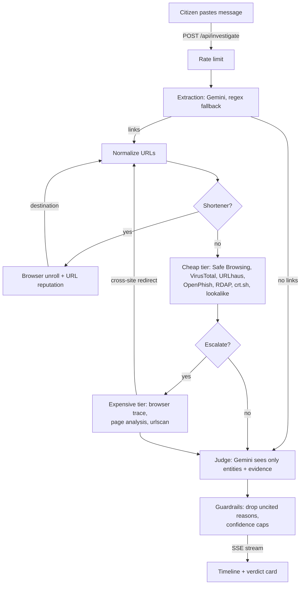

# Scam Investigator

Paste a suspicious SMS, WhatsApp message or link. An agent investigates it with **live**
security sources, streams every step to the page, and returns a verdict in which every
reason cites the evidence it came from.

No mock data: if a source is not configured or fails, it shows up as `unavailable`,
`error` or `timeout` — never as a made-up result.

## Setup (local)

Requires Python 3.11+.

```bash
python -m venv .venv
# Windows: .venv\Scripts\activate    macOS/Linux: source .venv/bin/activate
pip install -r requirements.txt
cp .env.example .env    # then fill in the keys you have
python -m playwright install chromium   # browser for the redirect tracer
uvicorn app.main:app --port 8000
```

On Windows don't add `--reload`: it switches to an event loop that cannot start the browser
(the browser checks then report `unavailable`).

Open http://localhost:8000. `GET /health` shows which keys are configured (names only).

The app starts with any subset of keys. Without `GEMINI_API_KEY`, extraction falls back
to a regex extractor and the verdict to a rule-based summary of blocklist hits.

### Keys

| Variable | Used by | Get one at |
|---|---|---|
| `GEMINI_API_KEY` | entity extraction + judge | aistudio.google.com/apikey |
| `GEMINI_MODEL_FAST` / `_BACKUP` | extraction (default `gemini-3.6-flash`, backup `gemini-3.5-flash-lite`) | — |
| `GEMINI_MODEL_JUDGE` / `_BACKUP` | judge (default `gemini-3.6-flash`, backup `gemini-3.5-flash-lite`) | — |
| `GOOGLE_SAFE_BROWSING_API_KEY` | Safe Browsing v4 | Google Cloud console |
| `VIRUSTOTAL_API_KEY` | VirusTotal v3 | virustotal.com |
| `URLSCAN_API_KEY` | urlscan.io search | urlscan.io |
| `URLHAUS_AUTH_KEY` | URLhaus | auth.abuse.ch |

RDAP, crt.sh, the OpenPhish community feed, the lookalike check and the browser tracer
need no key.

Each LLM step tries its primary model and, on failure (rate limit, timeout, block,
bad output), its backup model once. Defaults were picked by measured free-tier latency
(`gemini-3.8-flash` took 85-100+ s per call). All default models are on Gemini's free tier;
`gemini-4-argon` is a stronger judge but is paid-only. Note that on the free tier Google
may use submitted content to improve its products — enable billing before real users.

## Tests

```bash
python -m unittest discover -s tests -v
```

## Docker

```bash
docker build -t scam-investigator .
docker run --rm -p 8000:8000 --env-file .env scam-investigator
```

The image includes Playwright + Chromium for the upcoming browser tracer. `$PORT` is honoured.

## How it works

1. **Extract** — the fast Gemini model pulls links, phone numbers, UPI ids, the claimed brand,
   urgency cues and the requested action out of the message (wrapped in
   `<untrusted_message>` tags). Links it returns are kept only if they appear in the text.
2. **Cheap tier** (parallel, per link) — Safe Browsing, VirusTotal, URLhaus, OpenPhish, RDAP,
   crt.sh, plus a local lookalike check against a curated list of official brand domains.
3. **Shorteners** (bit.ly, tinyurl…) are opened in an isolated headless browser to find the
   real destination, which is then investigated as a new link.
4. **Escalate** if signals conflict, the domain is < 30 days old, a lookalike/suspicious signal
   appears, or nothing gave a clear signal — browser trace (redirects, password/OTP/card fields,
   APK downloads), Gemini page analysis of the landing page (in `<untrusted_page>` tags), and
   urlscan.io (existing scans, else a new unlisted scan). Redirects to another site are followed.
5. **Budget** — at most 12 external calls per case.
6. **Judge** — the Gemini judge model sees only the entities and the findings, and must
   cite finding ids. Reasons citing unknown ids are dropped; no-link cases are capped at 0.6
   confidence; if every live check failed the verdict is `cannot_determine`.

## Architecture



<!-- Replace or extend this diagram as you like. -->

## Privacy

User messages are never stored or logged. Third-party lookup services receive only URLs or
domains. The message text is sent only to the Gemini API for extraction. The browser tracer
opens suspicious links from the server (not the user's device) with downloads blocked and
private network addresses unreachable.

`/api/investigate` is rate limited (5/min and 30/hour per client, 3 concurrent). Behind a
reverse proxy, start uvicorn with `--proxy-headers` so limits apply per real client.
